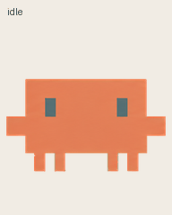
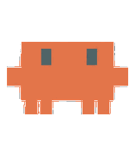
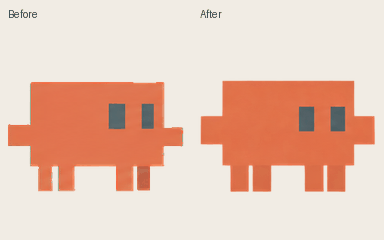

# Clawd

An orange crab companion for ChatGPT on Codex, with 9 animated states and 16 look directions.

Updated with alternating steps and stable ground alignment while dragging, plus consistent rectangular look poses.

Sprite sheet: `Clawd-spritesheet-v2.png` (v2 layout). Licensed under Apache-2.0; see [LICENSE](LICENSE).
